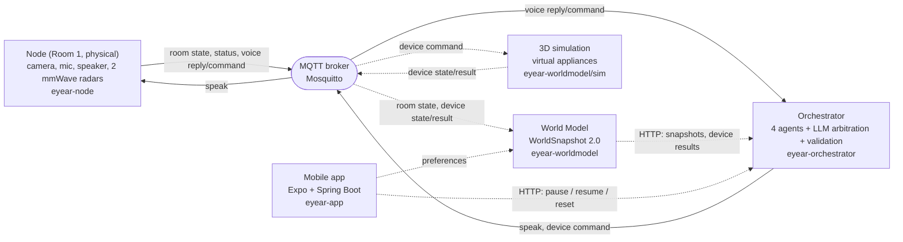

# EYEAR

**Eyes and Ears for Proactive Smart Home Orchestration through Spatial Awareness and Multi-Agent Collaboration**

Shared documents and system integration for [EYEAR](https://github.com/HY-LG-EYEAR) (Hanyang University, CSE406 Software Engineering & ITE351 AI & Applications).

## System

Solid lines are implemented on both sides; dashed lines are defined but not yet connected. Other rooms are fed by simulated Nodes. Details: [connection overview](https://github.com/HY-LG-EYEAR/eyear-team/blob/main/docs/connections.md).

- **Node** turns camera, microphone, and radar input into semantic room state; raw audio and video stay on the Node.
- **World Model** merges all rooms and devices into one versioned home snapshot.
- **Orchestrator** runs the Cleaning, Noise, Temperature, and Lighting agents. Non-conflicting proposals are accepted; for a conflict, an LLM picks one of the agents' options, with a deterministic fallback. Every command is validated before it is sent.

## Demonstration scenario

An evening at home: the robot vacuum is cleaning Room 2 with Room 1 next when resident A walks into Room 1, so it returns to the dock and keeps Room 1 for later. While A rests, the washer switches to low-noise mode and the Node asks once whether A is going to sleep; after "yes" the curtain closes and the light turns off. A later says "Hi LG, turn on the light". When A leaves, only Room 1 is cleaned, and the living-room AC adjusts to both residents' preferences.

## Components

| Repository | Purpose | Maintainer |
| --- | --- | --- |
| [eyear-node](https://github.com/HY-LG-EYEAR/eyear-node) | Room-level sensing, local perception, voice I/O | Banseok Shin |
| [eyear-worldmodel](https://github.com/HY-LG-EYEAR/eyear-worldmodel) | Home-wide state and 3D simulation | Hyochang Lee |
| [eyear-orchestrator](https://github.com/HY-LG-EYEAR/eyear-orchestrator) | Agents and central orchestration | Jungbin Song |
| [eyear-app](https://github.com/HY-LG-EYEAR/eyear-app) | Expo (React Native) mobile app and Spring Boot backend | Yewon Joung |

## Documents

- [Software Engineering document — Submissions C and D (architecture design, implementation, use cases)](docs/SE_G05_EYEAR_C%2BD.pdf)
- [LaTeX source](docs/main.tex)

## Status

Each component runs and is tested on its own. Connecting the World Model transport, the 3D simulation, the app, and the physical Node through the broker is in progress.

## Team coordination

Cross-component requests and updates are shared in [eyear-team](https://github.com/HY-LG-EYEAR/eyear-team).
